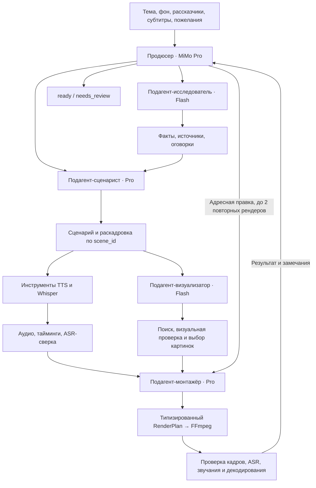

# Архитектура Brainrot Studio

Реализованная архитектура, 3 октября 2026. Google ADK: один агент-оркестратор и вызываемые им подагенты.

## Стек

| Слой | Реализация |
|---|---|
| UI | React 19, TypeScript, Vite, Lucide |
| API | Python 3.12, FastAPI, Pydantic, HTTPX |
| Агенты | Google ADK 2.11, LlmAgent, AgentTool, Runner |
| Модели | Адаптер ADK BaseLlm → OpenRouter Chat Completions |
| Поиск | OpenRouter web plugin, Exa |
| Голос | OpenRouter /audio/speech: Fish Audio; стандартные голоса Gemini TTS |
| Тайминги | faster-whisper small, CPU int8; независимое ASR и выравнивание текста сценария |
| Монтаж | FFmpeg/ffprobe, PyAV, Pillow; прозрачные растровые титры с точными PTS |
| Состояние | SQLite WAL + JSON/медиа, очередь в процессе API |
| Доставка | run.sh, Docker Compose |

## Агентная структура

Продюсер выбирает следующего исполнителя по артефактам. Специалист может вернуть проблему; продюсер заказывает пересценаривание, продолжает прерванное задание или пропускает этап при правке только титров. Каждый AgentTool имеет собственную инструкцию и ограниченный набор инструментов. Сохранение исследования, сценария и завершение визуальной ветки заканчивают текущий вызов специалиста; структурированный результат передаётся продюсеру без дополнительного LLM-пересказа. Монтажёр вызывает сборку и проверку, после которой управление всегда возвращается продюсеру. Замена источника поручается визуализатору, речь и длительность сценаристу, композиция монтажёру.

Отрицательная фактологическая рецензия сценария проходит один независимый adjudication-вызов Pro: он сверяет само замечание с источниками и сценарием. Это ограничивает циклы противоречивых замечаний, но не гарантирует истинность фактов. Повторный монтаж с неизменённым планом и теми же материалами отклоняется без расхода рендера.

Сценарист использует Pro, исследователь и визуализатор Flash. TTS, Whisper и FFmpeg являются инструментами без самостоятельного LLM-цикла. Ветки аудио и иллюстраций работают одновременно; голосовые реплики обрабатываются последовательно.

Две одинаковые последовательные ошибки инструмента завершают вызов подагента и возвращают причину продюсеру. Для исследователя и визуализатора сохраняется эскалация на Pro; остальные лимиты не сбрасываются. Уже найденные изображения можно заново осмотреть независимой vision-моделью через inspect_saved_images, не выполняя повторный сетевой поиск. Это восстановление по артефактам, а не отдельные правила для конкретных тем.

Завершение реализовано через публичные after_tool/after_agent callbacks ADK и временное состояние сессии. Нет подмены ответа редактора старой рецензией или отдельного ручного канала передачи. AgentTool оставлен намеренно: проверенный в ADK 2.11 single_turn превращал исключения подагента в строку, скрывая TimeoutError от очереди восстановления. Интеграционные тесты требуют возврата принятого артефакта без лишнего LLM-вызова и сохранения типа сетевой ошибки как из модели, так и из инструмента. Переход на другую композицию допустим после выполнения этих же контрактов.

## Контракты

- JobRequest: тема, фон, участники, язык, длительность, субтитры, пожелания, бюджет.
- Research: summary, facts, sources, caveats. Каждый HTTP(S)-URL должен иметь provider citation с извлечённой выдержкой. Ссылка в обычной прозе модели не принимается. Перед сохранением независимый вызов Pro сверяет факты с выдержками; конкретные замечания возвращаются исследователю, одинаковый результат проверки кэшируется. Модельная проверка не доказывает истинность источника.
- Script: title, hook, scenes. Уникальный scene_id, speaker_id, произносимый текст, запрос картинки и подпись. Все выбранные участники получают реплику.
- audio[scene_id]: путь, длительность, слова/тайминги, ASR similarity, fingerprint.
- visuals[scene_id]: скачанный файл с источником/автором/лицензией либо явное отсутствие вставки.
- RenderPlan: overlay/split, цвет/размер титров, размер персонажа, время вставки, скорость 0.85–1.25.
- Review: passed, summary, issues, suggested_plan.

У модели нет произвольного shell. Pydantic-план преобразуется в аргументы FFmpeg без shell-интерполяции.

## Переиспользование и восстановление

Сценарий имеет content hash. Аудио и визуал должны подтвердить этот hash перед монтажом. Изменение сценария инвалидирует видео и проверку. Подтверждённая раскадровка сохраняется при изменении только речи, если порядок сцен, scene_id, visual_query и visual_caption полностью совпадают. Изменённый визуальный замысел требует нового подтверждения; итоговая проверка всё равно оценивает картинки по актуальному тексту. Смена иллюстрации инвалидирует видео/проверку. Старые файлы сохраняются.

Кандидаты проходят первичный осмотр независимой vision-моделью. Визуализатор может назначить все изображения одним select_images: весь набор проверяется до применения, неизвестная сцена или картинка не оставляет частично изменённый план. Повторный осмотр сохранённых изображений нужен для неоднозначного результата или изменённого смысла, а не автоматически после каждой правки речи.

Кэш реплики зависит от текста, голосового пресета и языка. Правки фона/титров не требуют повторного TTS. Новая версия имеет parent_id и наследует только переиспользуемые артефакты.

Начальная оценка сценария 2.2 слова/сек не считается свойством всех голосов. После первой озвучки продюсер получает измеренный темп и рекомендуемый объём текста. Решение о пересценаривании использует фактические длительности реплик, допустимую скорость 0.85–1.25 и тот же порог отклонения, что финальная приёмка. Это позволяет работать с быстрыми, медленными и смешанными голосами без таблицы специальных правил по персонажам.

Перед FFmpeg preflight повторно проверяет посценную ASR-сверку и длительность с округлением до кадра. Известный дефект не расходует попытку рендера. Если одной скоростью его не исправить, инструмент завершает вызов монтажёра и передаёт продюсеру структурированный запрос пересценаривания с измеренными таймингами и несовпавшими репликами.

SQLite хранит jobs/events/charges, идемпотентные submissions и расписание charge_rechecks. При старте незавершённые running-задания становятся queued и автоматически продолжаются. Продолжение создаёт новую ADK-сессию и восстанавливает работу по артефактам, не по полной истории ADK или LangGraph-checkpoint. Очередь обслуживает один worker в FastAPI; OS-lock каталога данных не допускает второго владельца. Несколько worker/реплик намеренно не поддерживаются.

План доработки хранит выбранные продюсером стадии и незавершённые зависимости. Правка исследования требует нового сценария, сценарий требует подтверждения визуала; чисто монтажная правка не инвалидирует речь. Сохранённый сценарий защищён от перезаписи без запрошенной доработки либо конкретного дефекта. Инструменты измерения/рецензирования фиксируют намерение ремонта в артефактах, поэтому перезапуск не теряет его. Перед вызовом подагента проверяются предусловия ветки, не только перед FFmpeg.

Остановка сервера отменяет worker и его текущую работу; незавершённое задание остаётся queued, уже завершённое не меняет статус. Пользовательская отмена остаётся cancelled и не возобновляется сама. Отложенный retry имеет сохранённый retry_after и отдельный таймер, не занимает worker. Таймаут внешнего сервиса не стирает завершённые этапы и не освобождает неопределённые резервы. Возобновление переиспользует актуальные артефакты; устаревшую версию проверки нельзя обойти повторным монтажом или finish_project.

## Медиа

Фон обрезается под 9:16, исходный звук отключён. Повторы запрещены: API проверяет длину до платных вызовов, renderer повторно проверяет фактический покадровый таймлайн. Скорость речи не меняет скорость фона. У каждой реплики собственный рассказчик/голос; персонаж меняет сторону по участнику. Иллюстрации сверху, титры в центре, персонаж снизу. Lip-sync нет.

Длительности сцен кратны 1/30 секунды. Прозрачный QTRLE-трек титров кодируется PyAV с явными PTS; concat-demuxer для картинок не используется, поскольку его округление сдвигало короткие слова. Каждая реплика сначала нормализуется через FFmpeg loudnorm в отдельный 48 kHz stereo PCM-файл с точным количеством сэмплов. Промежуточный звук PCM, AAC кодируется один раз после склейки: нет накопления AAC padding между репликами. Финальная дорожка также ограничена точным количеством сэмплов таймлайна, затем проверяется громкость готового микса. Таймлайн сохраняется в JSON, SRT использует те же границы.

Титры группами по три слова выделяют активное слово. Текст измеряется шрифтом и уменьшается при нехватке ширины. Whisper small распознаёт аудио без подсказки исходного текста. Этот независимый результат остаётся для QA; при достаточном сходстве слова сценария выравниваются по найденным временным якорям для исправления написания. Версия распознавателя входит в метаданные кэша. Выход: MP4 H.264/AAC, yuv420p, 1080×1920/30fps и SRT.

Wikimedia Imageinfo отдаёт URL и лицензионные метаданные. Загрузчик проверяет HTTP(S), DNS/IP, редиректы, разрешённые Wikimedia-hosts, размер до 15 MB / 40 мегапикселей, декодирует и сохраняет PNG. Модель описывает кандидатов, визуализатор выбирает релевантные. При отсутствии материала сцена остаётся без вставки. Google и YouTube использовались для поиска референсов/пресетов, но runtime не управляет Chrome и не скачивает произвольные ролики YouTube.

## Проверка

1. ffprobe и полное FFmpeg/PyAV-декодирование: 1080×1920, аудио, непрерывные PTS 30 fps, отклонение MP4 от таймлайна не больше 60 мс.
2. Каждый кадр: чёрные кадры и неподвижный фон дольше 0.5 с. Узкие края кадра исключают статичные титры/персонажей из проверки движения.
3. Пиксельная сверка титров на середине каждого слова длительностью от 100 мс: минимум 80% проверяемых светлых пикселей должны соответствовать эталонному тексту/подсветке. Прозрачность и короткие слова отдельно покрыты регрессионными тестами.
4. Независимый ASR финального MP4: similarity ≥0.82, p95 отклонений начал совпавших слов ≤300 мс, систематический сдвиг ≤120 мс. ASR исходной реплики должен иметь similarity ≥0.90.
5. Звук: отсутствие клиппинга, чрезмерной тишины на концах, перепадов активного RMS между репликами больше 7 дБ и крупных разрывов waveform на стыках. Это технические эвристики, не замена слуховой оценке тембра.
6. Отклонение от запрошенной длительности не больше max(2 секунд, 8%).
7. Gemini 3.8 Flash: независимый от монтажёра вызов для кадра каждой сцены вместе с реальным исходным изображением вставки, текстом реплики и запланированной подписью. Имя файла не является описанием картинки. Проверяются композиция, соответствие источнику, релевантность и читаемость на телефоне; страницы документов и неразборчивые схемы не принимаются просто за совпадение темы. Отдельные вызовы устранили смешение порядка кадров в batch-ответах. Кэш содержит версию проверки, модель и SHA-256 видео. При смене проверяющей модели требуется новая проверка.
8. Gemini 3.8 Flash получает настоящую финальную дорожку, проверяет слышимые дефекты, ударения и акцент. Временные отметки обязаны попадать в длительность ролика. Некорректный ответ допускает один повтор, затем проверка не принимается. Мультяшный тембр сам по себе не является дефектом. Эта проверка вероятностная и не гарантирует человеческую оценку.

До трёх рендеров на задание. После успешной приёмки повторный монтаж блокируется до новой версии. После исчерпания попыток сценарист не инвалидирует последнюю версию новыми правками. Повреждённый JSON vision-модели допускает один повтор для конкретного кадра; уже проверенные кадры сохранены. finish_project может завершить неудачную попытку как needs_review, но ready требует видео, положительной visual-проверки, независимого AV-отчёта и проверки звучания. Каждый отчёт связан с SHA-256 файла. Lip-sync, точное сходство голоса и человеческая оценка юмора не входят в автоматическую приёмку.

Числа и проценты в ASR приводятся к словесной форме через num2words перед сравнением: «9%» не считается потерей слов «девять процентов». Независимый оригинальный транскрипт сохраняется без изменения. Версия выравнивания v5 инвалидирует старую разметку, не требуя повторной платной озвучки.

Отдельный бесплатный audit_backgrounds.py декодирует все установленные игровые фоны и ищет встроенные повторы: сравнение кадров 2 fps с лагом 1–60 секунд. Четыре секунды подряд почти идентичных кадров на одном лаге отклоняют источник. Это проверка на короткий повтор, а не доказательство уникальности каждого игрового эпизода.

## Безопасность и бюджет

Однопользовательский локальный интерфейс без авторизации. TrustedHost и Origin-проверка блокируют внешние записи; порт только loopback. Медиа-route не отдаёт БД, .env или произвольные файлы. Ключ не возвращается клиенту, исключён из Git/Docker context.

Ограничены токены и текстовый контекст; максимум три внешних запроса одновременно, 65 агентных LLM-вызовов и 100 действий за проход, три поиска исследования, четыре редакции сценария. Общий счётчик моделей находится в Gateway и охватывает продюсера и все вложенные вызовы, независимо от отдельных лимитов ADK-сессий. Поиск картинок ограничен восемью запросами, не больше двух на сцену. Сырые результаты не копируются во все последующие контексты; снимки артефактов не изменяются задним числом.

SQLite-резервы атомарны; дополнительный окончательный предел задаёт ключ OpenRouter. Транспорт не повторяет запросы скрытно. Worker допускает два восстановления задания после сетевых ошибок/429/5xx с паузами 15/45 секунд: новый ADK-проход использует сохранённые этапы и тот же бюджет. Незавершённый вызов может быть оплачен повторно, поэтому его неопределённый резерв остаётся до сверки. Валидация и исчерпание бюджета не запускают автоматический повтор. Цена TTS проверяется через X-Generation-Id и /generation.

## Источники

- [Google ADK](https://google.github.io/adk-docs/)
- [OpenRouter TTS](https://openrouter.ai/docs/guides/overview/multimodal/tts)
- [OpenRouter web search](https://openrouter.ai/docs/guides/features/plugins/web-search)
- [MediaWiki Imageinfo](https://www.mediawiki.org/wiki/API:Imageinfo)
- [faster-whisper](https://github.com/SYSTRAN/faster-whisper)
